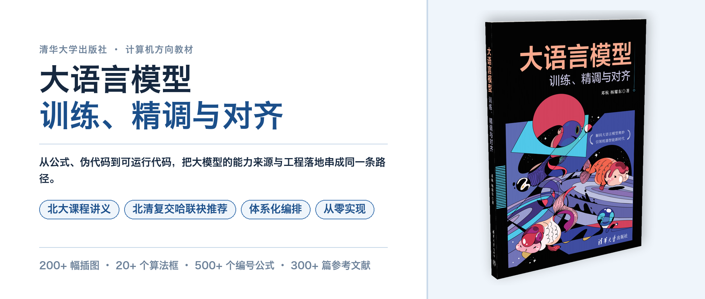

# Token-to-LLM

《大语言模型：训练、精调与对齐》配套资源仓库

## 目录

```
token-to-llm/
├── imgs/         # README 用图
├── src/          # 按章节组织的可运行代码，每个 .py 对应书中一处算法或一幅插图
├── ppt/          # 教学课件 PDF
├── tests/        # 批量运行脚本
├── LICENSE       # 仅限教学使用，商用需授权
└── requirements.txt
```

## 章节对照

| 章 | 章名 | 代码 | 课件 |
|---|---|---|---|
| 1 | 大语言模型综述 | [`src/llm/`](src/llm/) | ppt/llm.pdf |
| 2 | Transformer 模型 | [`src/transformer/`](src/transformer/) | ppt/transfomer.pdf |
| 3 | GPT | [`src/gpt/`](src/gpt/) |  [ppt/gpt.pdf](ppt/gpt.pdf) |
| 4 | Llama | [`src/llama/`](src/llama/) | ppt/llama.pdf |
| 5 | 有监督微调 | [`src/sft/`](src/sft/) | ppt/sft.pdf |
| 6 | 提示词工程和 LLM 应用 | [`src/prompt/`](src/prompt/) | ppt/prompt.pdf |
| 7 | 强化学习 | [`src/rl/`](src/rl/) | ppt/rl.pdf |
| 8 | 基于强化学习的LLM训练 | [`src/rl-llm/`](src/rl-llm/) | ppt/rl-llm.pdf |
| 9 | 大语言模型的训练 | [`src/training/`](src/training/) | ppt/training.pdf |
| 10 | 高效大语言模型 | [`src/inference/`](src/inference/) | ppt/inference.pdf |


## 运行

```bash
conda activate t2t
pip install -r requirements.txt

python src/transformer/scaled_dot_product_attention.py
python tests/run_all.py
```

## 引用

```bibtex
@book{deng2026llm,
  title     = {大语言模型：训练、精调与对齐},
  author    = {邓杭 and 杨耀东},
  publisher = {清华大学出版社},
  address   = {北京},
  year      = {2026},
  isbn      = {978-7-302-71036-3}
}
```



## 许可

本仓库的代码与课件**仅供教学与学习使用，不得用于任何商业用途**；
商用需经作者书面许可。详见 [LICENSE](LICENSE)。

