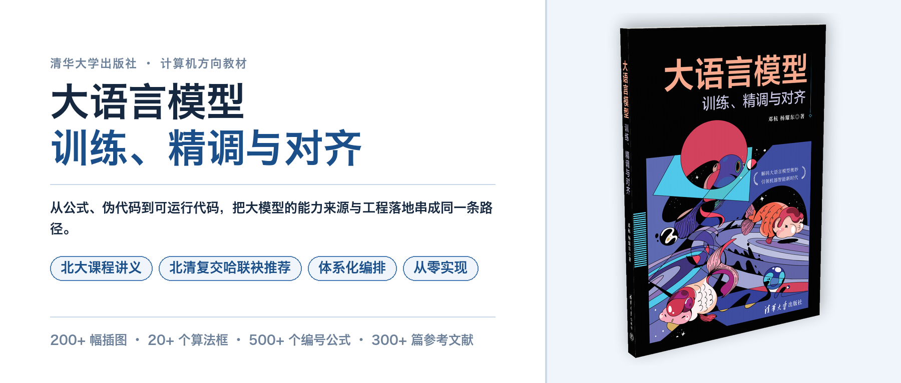

# Token-to-LLM

《大语言模型：训练、精调与对齐》配套资源仓库

## 目录

```
token-to-llm/
├── imgs/         # README 用图
├── src/          # 按章节组织的可运行代码，每个 .py 对应书中一处算法或一幅插图
├── ppt/          # 教学课件 PDF
├── tests/        # 批量运行脚本
├── LICENSE       # 仅限教学使用，商用需授权
└── requirements.txt
```

## 课时对照

| 课时 | 章节 | 章节名 | 代码 | 文件名 |
|---|---|---|---|---|
| 1 | 1 | 大语言模型综述 | [`src/llm/`](src/llm/) | [./ppt_16/llm.pdf](./ppt_16/llm.pdf) |
| 2 | 2 | Transformer 模型（上） | [`src/transformer/`](src/transformer/) | [./ppt_16/transformer_part_1.pdf](./ppt_16/transformer_part_1.pdf) |
| 3 | 2 | Transformer 模型（下） | [`src/transformer/`](src/transformer/) | [./ppt_16/transformer_part_2.pdf](./ppt_16/transformer_part_2.pdf) |
| 4 | 3 | GPT 模型 | [`src/gpt/`](src/gpt/) | [./ppt_16/gpt.pdf](./ppt_16/gpt.pdf) |
| 5 | 4 | Llama 模型（上） | - | [./ppt_16/llama_part_1.pdf](./ppt_16/llama_part_1.pdf) |
| 6 | 4 | Llama 模型（下） | [`src/llama/`](src/llama/) | [./ppt_16/llama_part_2.pdf](./ppt_16/llama_part_2.pdf) |
| 7 | 5 | 有监督微调 | - | [./ppt_16/finetune.pdf](./ppt_16/finetune.pdf) |
| 8 | 6 | 提示词工程和 LLM 应用 | - | [./ppt_16/prompt.pdf](./ppt_16/prompt.pdf) |
| 9 | 7 | 强化学习（上） | [`src/rl/`](src/rl/) | [./ppt_16/rl_part_1.pdf](./ppt_16/rl_part_1.pdf) |
| 10 | 7 | 强化学习（下） | [`src/rl/`](src/rl/) | [./ppt_16/rl_part_2.pdf](./ppt_16/rl_part_2.pdf) |
| 11 | 8 | 基于强化学习的 LLM 训练（上） | [`src/rl-llm/`](src/rl-llm/) | [./ppt_16/rl-llm_part_1.pdf](./ppt_16/rl-llm_part_1.pdf) |
| 12 | 8 | 基于强化学习的 LLM 训练（下） | [`src/rl-llm/`](src/rl-llm/) | [./ppt_16/rl-llm_part_2.pdf](./ppt_16/rl-llm_part_2.pdf) |
| 13 | 9 | 大语言模型的训练（上） | - | [./ppt_16/training_part_1.pdf](./ppt_16/training_part_1.pdf) |
| 14 | 9 | 大语言模型的训练（下） | - | [./ppt_16/training_part_2.pdf](./ppt_16/training_part_2.pdf) |
| 15 | 10 | 高效大语言模型（上） | [`src/inference/`](src/inference/) | [./ppt_16/inference_part_1.pdf](./ppt_16/inference_part_1.pdf) |
| 16 | 10 | 高效大语言模型（下） | [`src/inference/`](src/inference/) | [./ppt_16/inference_part_2.pdf](./ppt_16/inference_part_2.pdf) |

章节共 10 章，拆分成 16 个课时周，满足课堂教学使用。

- `./ppt`:  10个章节
- `./ppt_16`:  16个课时

## 运行

```bash
conda activate t2t
pip install -r requirements.txt

python src/transformer/scaled_dot_product_attention.py
python tests/run_all.py
```

## 引用

```bibtex
@book{deng2026llm,
  title     = {大语言模型：训练、精调与对齐},
  author    = {邓杭 and 杨耀东},
  publisher = {清华大学出版社},
  address   = {北京},
  year      = {2026},
  isbn      = {978-7-302-71036-3}
}
```



## 许可

本仓库的代码与课件**仅供教学与学习使用，不得用于任何商业用途**；
商用需经作者书面许可。详见 [LICENSE](LICENSE)。

